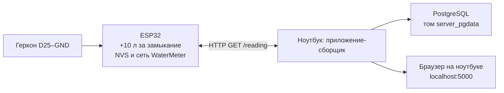

# Переносимая демонстрация счётчика воды

Реализация работает через собственную сеть ESP32 без внешнего роутера.
Плату пользователь прошивает по USB и подключает ноутбук к новой сети вручную.
Проверка всей цепочки на физическом оборудовании проводится после прошивки;
текущий Wi-Fi ноутбука автоматически не меняется.

## Компоненты и адреса



| Компонент | Настройка |
|---|---|
| Wi-Fi ESP32 | SoftAP `WaterMeter`, пароль `12341234`, канал 1 |
| ESP32 | `192.168.4.1`, маска `255.255.255.0` |
| Ноутбук | Обычный DHCP, без фиксированного адреса |
| Клиенты | Один одновременно; без MAC-фильтра и привязки к конкретному ПК |
| HTTP ESP32 | Порт 80, `GET /reading` и `GET /health` |
| Опрос | Примерно каждые 5 секунд; тайм-аут запроса 3 секунды |
| Страница | `http://localhost:5000`, опубликована на `127.0.0.1` |
| БД для приложения | Сервис Docker `postgres:5432` |

Инициатор обмена — ноутбук: он запрашивает известный адрес ESP32. Адрес ноутбука
может меняться, поэтому прошивке не нужен URL компьютера. При единственном
Wi-Fi адаптере WaterMeter заменяет подключение к домашней/вузовской сети.
Интернет локальному обмену не требуется. Для одного счётчика достаточно HTTP.

## Измерение и постоянная память

Геркон D25–GND использует внутреннюю подтяжку к 3,3 В. Оба уровня подтверждаются
после 100 мс. Новое замыкание добавляет 10 л, отпускание разрешает следующее.
D2 показывает подтверждённое замыкание. Начальный уровень при включении не
считается срабатыванием. Задача опроса отделена от обслуживания HTTP.

Сохранены пространство NVS **water-deb10-v4**, ключ **pulses**, формат четырёх
байт `uint32_t` и опорная константа локального `config.h` **1090 л**:

```text
накопленные литры = 1090 + число сохранённых замыканий × 10
```

Смена сети не обнуляет счётчик. Для обычной перепрошивки сохраняются рабочая
калибровка, формат и пространство NVS, разметка flash и отключённое стирание.
`config.example.h` с нулевой опорной отметкой предназначен для новой установки.

Основной цикл сохраняет счётчик после каждого замеченного изменения независимо
от наличия ноутбука; неизменившееся значение не переписывается. До HTTP 200
сохраняется именно возвращаемый снимок. Ошибка памяти, счётчика или калибровки
даёт 503; повреждённый сохранённый счётчик автоматически не заменяется нулём.
Старого десятисекундного интервала нет. При обрыве питания до завершения записи
последнее событие всё же может потеряться.

## HTTP, сборщик и история

`GET /reading` и `GET /health` возвращают одинаковые поля. Пример формата:

```json
{
  "liters": 1100.0,
  "ready": true,
  "storage_ok": true,
  "contact_closed": false,
  "device_id": "MAC точки доступа",
  "uptime_ms": 12345
}
```

Сборщик принимает только HTTP 200 с готовым сохранённым состоянием, конечными
неотрицательными литрами и корректными служебными полями. Показание становится
актуальным для страницы после успешной транзакции БД. Оно сравнивается с
последней строкой: одинаковый итог не добавляет строку даже после перезапуска.
Вставки синхронизированы транзакционной блокировкой. Автоматический сборщик
отклоняет уменьшение итога. `POST /water` оставлен для совместимости;
основной обмен использует GET.

В `water_log` остаются `id`, `liters`, `created_at`. Время строки — время
получения нового итога компьютером. Если в БД было 1200 л, а без ноутбука
ESP32 досчитала до 1270 л, после подключения сохраняется 1270 л. Разность 70 л
известна; время семи отдельных срабатываний из общего счётчика не восстановить.
Литры являются накопленными и не суммируются по строкам.

Страница `/` читает состояние сборщика из `/status`, историю из `/water/stats`.
При потере связи последнее значение остаётся с отметкой о неактуальности
(`stale`); `/status` содержит также ошибку и время последнего успешного чтения.
`/ping` проверяет только работающий процесс приложения.

## Запуск и сохранение базы

`server/docker-compose.yml` запускает PostgreSQL и приложение. Имя проекта
`server` и явное имя тома `server_pgdata` сохраняют существующую базу. Приложение
обращается к БД внутри Docker на `postgres:5432`; порт 5433 компьютера сохранён
для прямого доступа. Браузер использует локальный порт 5000.

1. При интернете выполнить `./server/prepare.sh`: загрузить PostgreSQL и собрать
   `water-meter-app:local`.
2. Загрузить прошивку без erase, включить ESP32, подключить ноутбук к WaterMeter.
3. Выполнить `./server/run.sh`, открыть `http://localhost:5000`.

`run.sh` использует `docker compose up --no-build --pull never`: на месте не
собирает и не скачивает образы. Терминал показывает логи; Ctrl+C останавливает
сервисы, история остаётся в томе. Повторный запуск — той же командой.
Нельзя удалять `server_pgdata` или выполнять `down -v`. Резервная копия:
`server/backups/water_db_before_drop_pulses_20261107_212344.dump`.

Пользовательские USB Serial-логи отключены. Для накопления при выключенном
ноутбуке ESP32 нужна независимая подача питания: USB может выключаться.
Постоянная точка доступа потребляет энергию непрерывно; срок работы от батарей
требует измерения и не приравнивается к режиму глубокого сна.

## Проверка на оборудовании после прошивки

1. Подключить ноутбук к WaterMeter с обычным DHCP, открыть страницу приложения.
2. Замкнуть и отпустить геркон: D2 меняется, итог увеличивается на 10 л,
   в истории появляется новое значение.
3. Дождаться нескольких опросов без срабатываний: повторных строк нет.
4. Остановить приложение, принять несколько срабатываний на ESP32, запустить
   приложение: сохраняется полный накопленный итог.
5. После успешного сохранения перезапустить ESP32: итог восстанавливается.
6. Переподключить Wi-Fi: опрос продолжается без изменения IP ноутбука в прошивке;
   при разрыве страница помечает последнее значение устаревшим.

Проверочные срабатывания входят в рабочий счёт. Этот список не означает,
что аппаратные проверки уже проведены.
